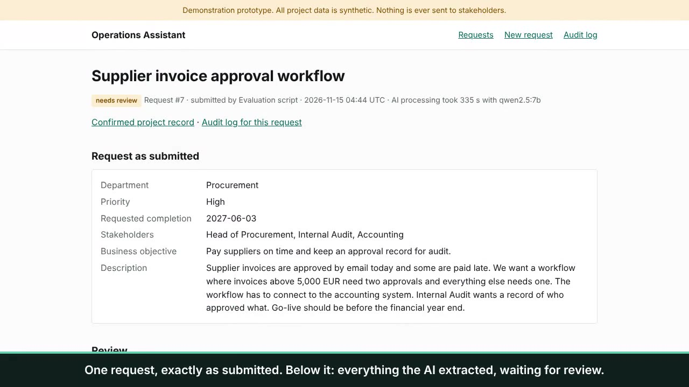
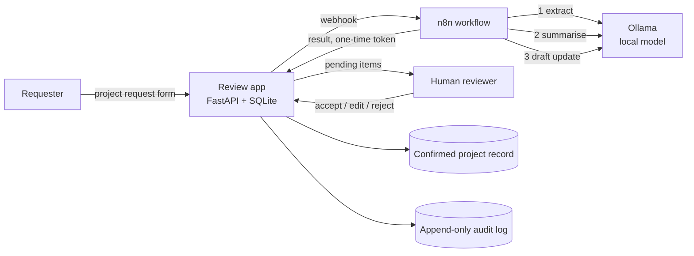
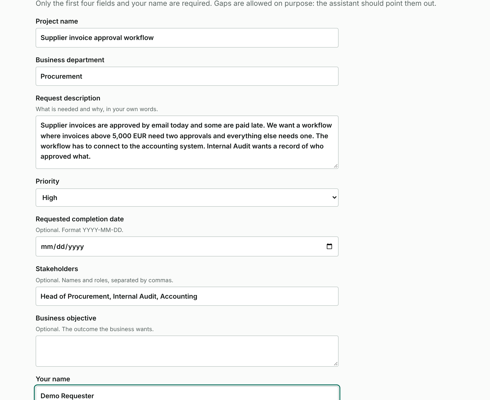
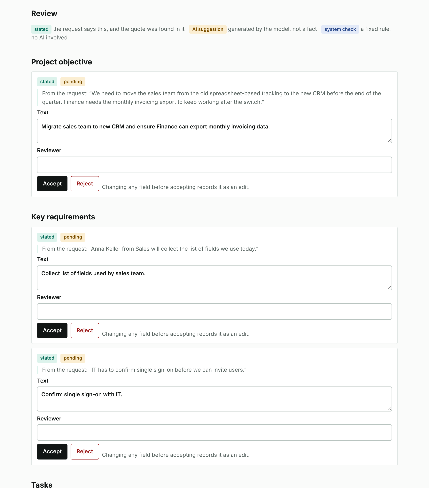
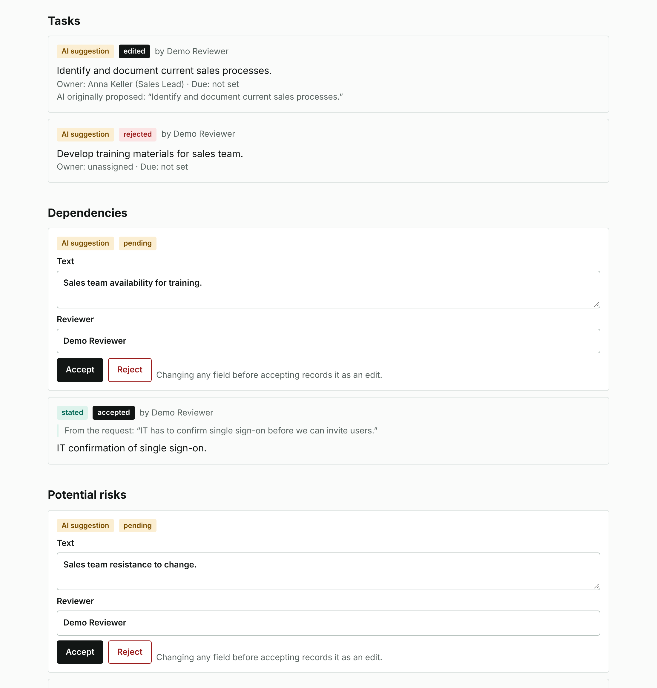
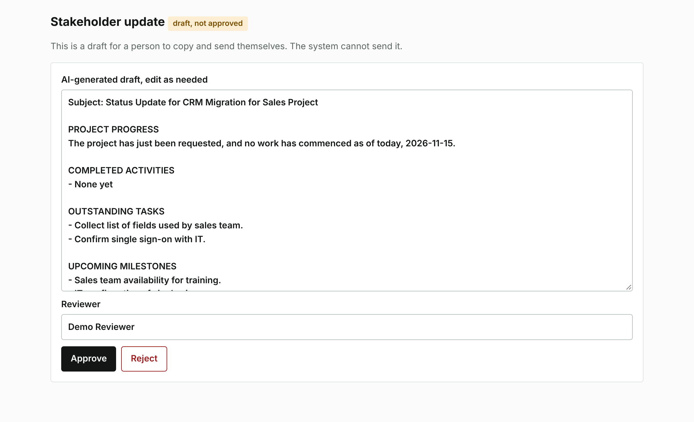
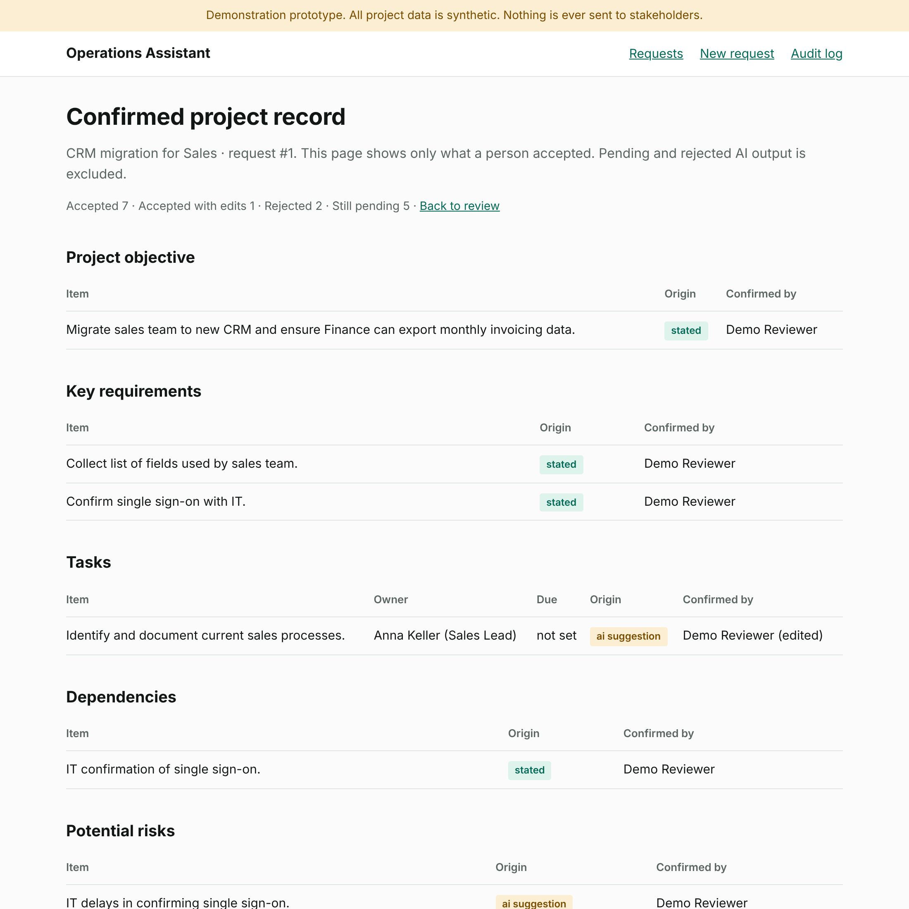
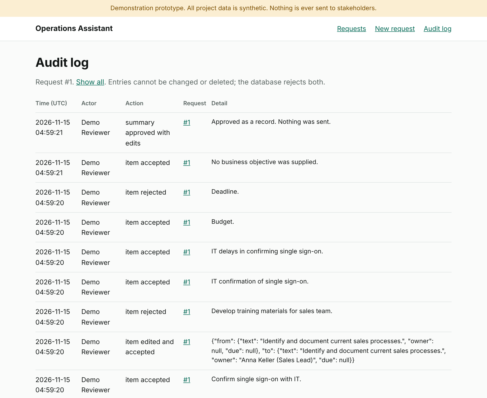

# Intelligent Business Operations Assistant

AI-assisted project coordination and stakeholder management, with a human approving every AI output.

> **Independent portfolio project.** This is a demonstration prototype built by Rashmi Singh. It is not a commercial implementation and was not built for a client. All project data in it is synthetic.

## See it working

[](docs/prototype-walkthrough.mp4)

[Watch the walkthrough](docs/prototype-walkthrough.mp4) (48 seconds, no sound): a reviewer edits an AI-suggested task owner, rejects a wrong AI flag, and the result appears in the confirmed record and the audit log. It uses the synthetic test data. The full case study is on the [portfolio website](https://rashmi-singh.rashmissingh97.workers.dev/ai-lab/intelligent-business-operations-assistant/).

There is no public live demo: the prototype runs an AI model on your own machine and must not be exposed to the internet. Follow the setup below to run it yourself.

## What it does

1. A user submits a project request through a form.
2. An n8n workflow sends the request to an AI model running on the same machine.
3. The model extracts the objective, requirements, tasks, suggested owners, dependencies, risks and missing information, then drafts a project summary and a stakeholder update.
4. Everything the AI produced waits in a review screen. A person accepts, edits or rejects each item.
5. Only accepted items appear in the confirmed project record. Every decision is written to an audit log.

The system has no email or messaging capability. A stakeholder update can be approved, but a person has to copy and send it themselves.

## Architecture



| Part | Role | Licence |
|---|---|---|
| Review app (`app/`) | Intake form, validation, review screen, records, audit log | This repository |
| n8n Community Edition (`n8n/workflows/`) | Runs the automation: three model calls, then hands the result back | Sustainable Use License. Free to self-host, **not open source** |
| Ollama | Runs the language model locally | MIT |
| Qwen2.5 7B (default model) | Extraction and drafting | Apache 2.0 |
| SQLite | Storage | Public domain |

No cloud AI service is used and no API key is needed. Nothing leaves your machine.

## How human oversight is enforced

| Control | Where it lives |
|---|---|
| AI output is stored as `pending` and is excluded from the project record until reviewed | `app/main.py`, `record_page` |
| Each item is labelled **stated**, **AI suggestion** or **system check** | `items.provenance` |
| A "stated" label is only kept if the model's quote is really found in the request text. Otherwise it is downgraded to "AI suggestion" | `evidence_found` |
| Risks and missing information are always labelled as suggestions | `store_ai_result` |
| Owners and due dates proposed by the AI are only applied when a reviewer accepts them; the original proposal is kept next to any edit | `items.ai_owner`, `items.owner` |
| Stakeholder updates stay drafts until approved, and approval sends nothing | `review_document` |
| The audit log cannot be updated or deleted; the database rejects both | triggers in `app/db.py` |
| The workflow can only write back with a one-time token issued for that request | `check_callback` |

## Run it with Docker Compose

Requirements: Docker Desktop, about 8 GB of free memory and 6 GB of disk for the default model.

```bash
git clone https://github.com/me-sunshine/ops-assistant.git
```

```bash
cd ops-assistant
```

```bash
docker compose up -d --build
```

The first start downloads the model (about 4.7 GB). Follow the download with:

```bash
docker compose logs -f ollama-pull
```

Then open <http://localhost:8000>. The n8n editor is at <http://localhost:5678> and asks you to create a local owner account the first time.

Stop everything with:

```bash
docker compose down
```

Your data stays in Docker volumes. Add `-v` to that command to delete it.

> The Compose file was written for this project but could not be run in the cloud environment where the prototype was developed, because container image downloads were cut off there. The prototype itself was developed and tested with the same three components running directly (see below). Treat the first Compose start on your machine as a test and report what you see.

## Run it without Docker

This is the setup the prototype was tested with.

1. Install [Ollama](https://ollama.com/download) and download the model:

   ```bash
   ollama pull qwen2.5:7b
   ```

2. Install n8n. It needs **Node.js 24** (version 22.22 or later 22.x also works). Do not use Node.js 26 or newer: one of n8n's parts has no ready-made build for it, and the install fails unless you have C++ build tools. Get Node.js 24 from https://nodejs.org/dist/latest-v24.x/ (on Windows, the file ending `-x64.msi`), then close and reopen your terminal. Import the workflow and start n8n:

   ```bash
   npm install -g n8n@2.35.7
   ```

   ```bash
   n8n import:workflow --input=n8n/workflows/project-intake.json
   ```

   ```bash
   n8n publish:workflow --id=projectIntake01
   ```

   ```bash
   n8n start
   ```

3. In a second terminal, start the review app (needs Python 3.11 or newer):

   ```bash
   pip install -r app/requirements.txt
   ```

   ```bash
   python -m uvicorn app.main:app --host 127.0.0.1 --port 8000
   ```

4. Open <http://localhost:8000> and submit a request. Sample requests are in `data/sample_requests.json`.

## Using a smaller or different model

Set `OLLAMA_MODEL` in a `.env` file (copy `.env.example`). Any Ollama model that supports structured output works. Smaller models are faster and less accurate. Check the model's licence on its Ollama library page before using it.

## Troubleshooting

**http://localhost:8000 says "This site can't be reached" or "connection refused".**
Nothing is answering on port 8000. `localhost` means your own computer, so the prototype only opens while it is running there.

- With Docker: open Docker Desktop and wait until it says it is running, then run `docker compose ps` in the project folder. The `app` line must say `Up`. If it is missing or says `Exited`, run `docker compose logs app` to see why.
- Without Docker: the terminal running `python -m uvicorn app.main:app ...` must stay open. Closing it stops the prototype.
- Try http://127.0.0.1:8000 instead. On some computers `localhost` points to a different network address than the one the app listens on.

**`npm : The term 'npm' is not recognized` (Windows) or `npm: command not found` (Mac).**
Node.js is not installed, or the terminal was opened before it was installed. Install Node.js 24 from https://nodejs.org/dist/latest-v24.x/, close every terminal window, open a new one and check with `node --version`. It must start with v24 (or v22.22 or later).

**`npm.ps1 cannot be loaded because running scripts is disabled on this system` (Windows).**
Windows PowerShell blocks the npm script. Either type `npm.cmd` in place of `npm`, or allow signed scripts for your own account once with `Set-ExecutionPolicy -Scope CurrentUser RemoteSigned`.

**`Error: Cannot find module '...\\node_modules\\n8n\\bin\\n8n'` after installing n8n.**
The n8n install stopped partway, almost always because Node.js is version 26 or newer. Check with `node --version`. Uninstall that Node.js, install Node.js 24 as above, open a new terminal, then run `npm uninstall -g n8n` followed by `npm install -g n8n@2.35.7`. The install has worked when it ends without lines starting `npm error` and `n8n --version` prints `2.35.7`.

**`ModuleNotFoundError: No module named 'app'`.**
You started uvicorn from inside the `app` folder. Go up one level to the project folder (where `docker-compose.yml` is) and start it from there.

**`TypeError: unsupported operand type(s) for |` when starting.**
Your Python is older than 3.10. Install Python 3.11 or newer.

**"Address already in use" or "port is already allocated".**
Another program is using port 8000. Stop it, or start the prototype on another port: `--port 8001` without Docker, or change `127.0.0.1:8000:8000` to `127.0.0.1:8001:8000` in `docker-compose.yml`. Then open http://localhost:8001.

**The page opens, but every request ends as "failed".**
The AI side is not ready. Run `docker compose logs ollama-pull`: the model download (about 4.7 GB) must finish with `success`. Without Docker, check that `ollama list` shows `qwen2.5:7b` and that n8n is running with the workflow published.


```bash
pip install pytest && python -m pytest tests
```

The automated tests cover input validation, missing-information checks, handling of AI output (including malformed output), the approval rules and the audit log. They replace n8n with a stub, so they run in seconds without a model.

To measure the real workflow against the sample dataset (takes several minutes per request on a laptop CPU):

```bash
python eval/run_eval.py
```

Results and limitations are in [`docs/TEST_REPORT.md`](docs/TEST_REPORT.md).

## Security notes

- All ports are bound to `127.0.0.1`. Do not publish them to the internet: the review app has no login, because it is a single-user local demonstration.
- The Ollama port is not published at all in the Compose setup.
- There are no secrets in this repository and none are needed.
- Use synthetic data only.

## Repository layout

```
app/                  review app (FastAPI, Jinja templates, SQLite)
n8n/workflows/        the n8n workflow, importable JSON
data/                 synthetic sample requests with an answer key
eval/                 evaluation script and saved results
tests/                automated tests
docs/                 test report and screenshots
docker-compose.yml    local stack: ollama, n8n, app
```

## Screenshots

| | |
|---|---|
|  Intake form |  AI output waiting for review |
|  Accepted, edited and rejected items |  Stakeholder update, draft only |
|  Confirmed project record |  Audit log |

## Measured results

From the evaluation of 15 November 2026 (8 synthetic requests, Qwen2.5 7B on 4 CPU cores): all 8 requests completed, median processing time 298 seconds, 24 of 31 stated facts captured, 20 of 26 known gaps detected. The full report, including the errors the review step caught and what has not been measured, is in [`docs/TEST_REPORT.md`](docs/TEST_REPORT.md).
